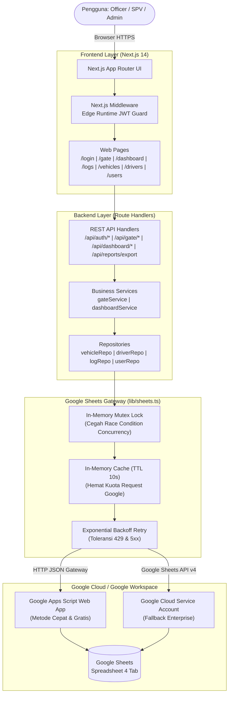
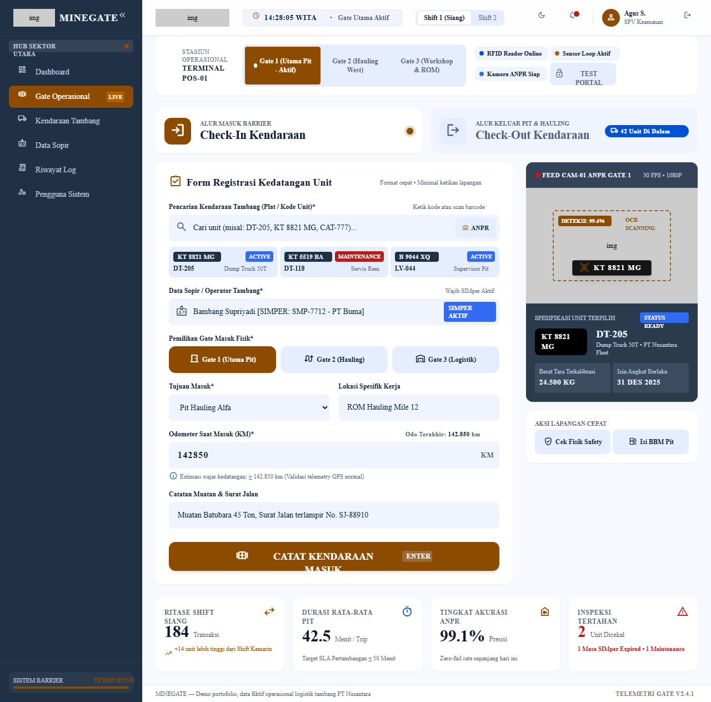
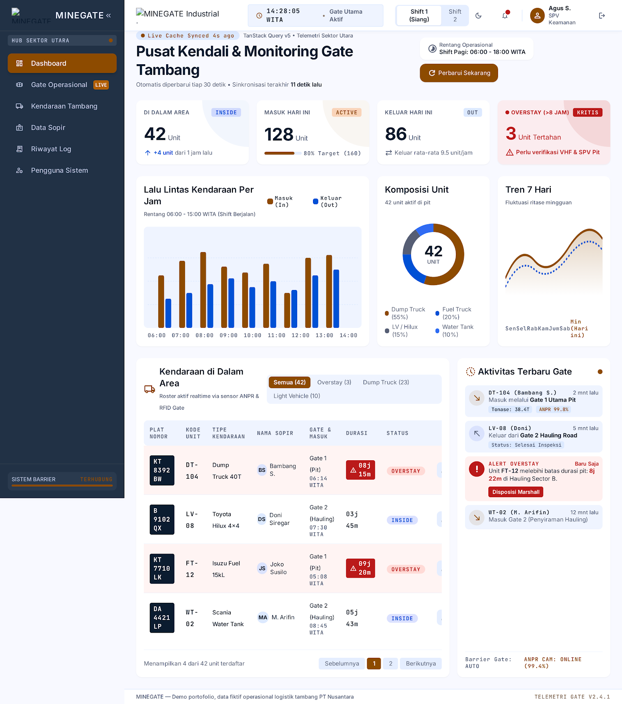
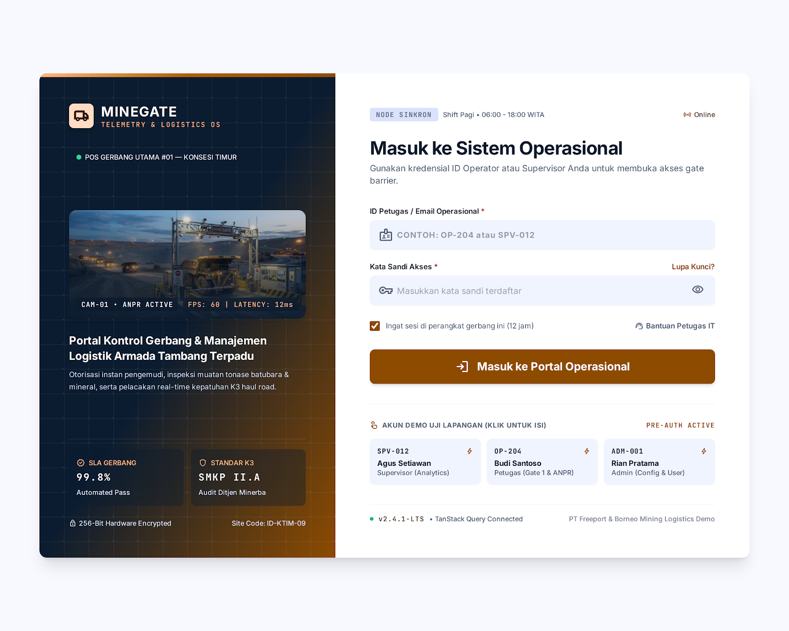

# 🚜 MINEGATE — Mining Vehicle Gate Management System

> **Portal Kontrol Gerbang & Manajemen Logistik Armada Tambang Terpadu**  
> Solusi digital berbasis cloud untuk pencatatan keluar-masuk kendaraan tambang, validasi K3 otomatis, pencegahan duplikasi *check-in*, dan pemantauan armada *overstay* secara terpusat dengan persistensi data **Google Sheets API v4 / Apps Script Web App**.

---

## 📌 1. Deskripsi & Tujuan Proyek

**MINEGATE** adalah aplikasi web manajemen logistik pos gerbang (*security & dispatch gate*) pada area operasional pertambangan terbuka (*open-pit mining*). Sistem ini dirancang untuk mengatasi inefisiensi pencatatan buku manual konvensional, meminimalisir kesalahan manusia (*human error*), serta meningkatkan standar Keselamatan dan Kesehatan Kerja (K3) dengan menyaring status kelaikan kendaraan dan izin operasional sopir secara *real-time*.

> [!IMPORTANT]
> **DISCLAIMER**: Proyek ini merupakan studi kasus portofolio independen yang terinspirasi dari tantangan operasional logistik pertambangan aktual di Indonesia. **Semua data entitas (kendaraan, sopir, pengguna, lokasi, dan log) adalah FIKTIF**. Sistem ini tidak menggunakan logo resmi maupun terafiliasi dengan entitas korporasi tertentu.

---

## 🌟 2. Daftar Fitur Unggulan

### 🔐 A. Otentikasi & Otorisasi Berbasis Peran (RBAC)
- **Token JWT via HttpOnly Secure Cookie**: Kedaluwarsa 8 jam, mencegah serangan XSS/CSRF.
- **Enkripsi Sandi Terstandarisasi**: Hashing kata sandi menggunakan `bcryptjs` dengan salt round 10.
- **Tiga Tingkat Akses Pengguna**:
  - `OFFICER` (Petugas Lapangan): Akses pos operasional `/gate` dan pencatatan riwayat `/logs`. Dilarang membuka `/dashboard` dan `/users`.
  - `SUPERVISOR` (Pengawas Operasional): Akses metrik `/dashboard`, pemantauan *overstay*, dan ekspor laporan CSV Excel.
  - `ADMIN` (Administrator Sistem): Akses penuh ke seluruh menu, termasuk manajemen master kendaraan, sopir, dan pengguna sistem `/users`.

### 🚧 B. Pos Gerbang Operasional (/gate)
- **Cek Masuk (Check-In) Validasi Ketat**:
  - Filter kelaikan unit: Kendaraan berstatus `MAINTENANCE` atau `INACTIVE` otomatis ditolak.
  - Filter sopir: Sopir berstatus `INACTIVE` dilarang mengemudikan kendaraan ke dalam pit.
  - *Anti-Duplicate Check-in*: Mencegah unit yang sudah berada di dalam pit tercatat masuk kembali sebelum keluar.
  - Validasi odometer: Odometer masuk tidak boleh lebih kecil dari odometer riwayat terakhir.
- **Cek Keluar (Check-Out) Cepat**:
  - Modal interaktif dengan prefill data masuk.
  - Deteksi regresi odometer: Odometer keluar tidak boleh lebih kecil dari odometer saat masuk.
  - Otomatis memperbarui `last_odometer` pada data induk kendaraan.
- **Live Inside Vehicles Table**: Daftar kendaraan aktif di area konsesi dengan penanda durasi dinamis dan *badge* darurat jika melebihi batas waktu toleransi (*overstay*).

### 📊 C. Dashboard Eksekutif & Pemantauan Overstay (/dashboard)
- **Kartu Ringkasan KPI**: Total unit di dalam pit, total masuk hari ini, total keluar hari ini, dan rata-rata durasi hauling dalam format jam-menit.
- **Daftar Peringatan Overstay**: Menampilkan kendaraan yang berada di area tambang melebihi batas toleransi (konfigurasi default: > 12 jam) untuk mitigasi insiden K3.
- **Komposisi Armada**: Grafik batang distribusi unit yang sedang beroperasi per kategori (*Dump Truck*, *Water Truck*, *Fuel Truck*, *Bus*, *Light Vehicle*, *Support*).
- **Aktivitas Terkini**: Tabel 10 transaksi *gate* paling akhir secara kronologis.

### 📋 D. Riwayat Log & Ekspor Laporan (/logs)
- **Pencarian Cepat & Filter Multi-Kriteria**: Pencarian berdasarkan kode unit/plat nomor/nama sopir, filter status (`INSIDE`/`OUT`), dan filter pos gerbang (`GATE_1_MAIN`, `GATE_2_PIT`, `GATE_3_WORKSHOP`).
- **Paginasi Responsif**: Navigasi halaman yang lancar dan cepat.
- **Ekspor CSV Kompatibel Microsoft Excel**: Dilengkapi dengan **UTF-8 Byte Order Mark (BOM: `0xEF, 0xBB, 0xBF`)** agar karakter khusus, tanggal WITA, dan header kolom terbuka sempurna tanpa teks rusak (*garbled text*).

---

## 🏛️ 3. Diagram Arsitektur Sistem



---

## 📑 4. Skema Data Google Sheets

MINEGATE menggunakan spreadsheet Google Sheets yang terdiri dari 4 tab utama:

| Nama Tab | Header Kolom | Deskripsi Entitas |
| :--- | :--- | :--- |
| `vehicles` | `vehicle_id`, `unit_code`, `plate_number`, `type`, `brand_model`, `owner_company`, `status`, `last_odometer`, `created_at` | Data master unit armada tambang |
| `drivers` | `driver_id`, `name`, `sim_number`, `sim_type`, `sim_expiry`, `company`, `phone`, `status`, `created_at` | Data master pengemudi & lisensi K3 |
| `gate_logs` | `log_id`, `vehicle_id`, `driver_id`, `gate`, `purpose`, `destination`, `time_in`, `time_out`, `odometer_in`, `odometer_out`, `status`, `officer_id`, `notes` | Buku besar transaksi keluar-masuk |
| `users` | `user_id`, `username`, `password_hash`, `name`, `role`, `status`, `created_at` | Kredensial akun & otorisasi peran |

### Format ID & Tipe Data Enumerasi
- **ID Kendaraan**: `VH-001`, `VH-002`, dst.
- **ID Pengemudi**: `DR-001`, `DR-002`, dst.
- **ID Pengguna**: `USR-001`, `USR-002`, dst.
- **ID Gate Log**: `LOG-YYYYMMDD-001` (Urut harian zona waktu WITA).
- **Vehicle Type**: `DUMP_TRUCK`, `WATER_TRUCK`, `FUEL_TRUCK`, `BUS`, `LIGHT_VEHICLE`, `EXCAVATOR_SUPPORT`.
- **Vehicle Status**: `ACTIVE`, `MAINTENANCE`, `INACTIVE`.
- **Driver Status**: `ACTIVE`, `INACTIVE`.
- **Gate Station**: `GATE_1_MAIN`, `GATE_2_PIT`, `GATE_3_WORKSHOP`.
- **Log Purpose**: `HAULING`, `OPERATIONAL`, `MAINTENANCE`, `LOGISTICS`, `OTHER`.
- **Log Status**: `INSIDE`, `OUT`.
- **User Role**: `ADMIN`, `SUPERVISOR`, `OFFICER`.

---

## ⚖️ 5. Tujuh (7) Aturan Bisnis Inti MINEGATE

1. **Anti-Duplicate Check-in (Status 409)**: Kendaraan yang masih tercatat berstatus `INSIDE` dilarang keras melakukan *check-in* ulang sebelum menyelesaikan transaksi *check-out*.
2. **Anti-Phantom Check-out (Status 409)**: Kendaraan hanya dapat di-*check-out* jika memiliki transaksi aktif berstatus `INSIDE`.
3. **Filter K3 Kendaraan (Status 422)**: Kendaraan dengan status kelaikan `MAINTENANCE` atau `INACTIVE` ditolak saat *check-in*.
4. **Filter K3 Pengemudi (Status 422)**: Pengemudi berstatus `INACTIVE` ditolak saat *check-in*.
5. **Integritas Odometer Masuk (Status 422)**: Odometer saat masuk tidak boleh lebih kecil dari odometer terakhir kendaraan (`last_odometer`).
6. **Integritas Odometer Keluar (Status 422)**: Odometer saat keluar tidak boleh lebih kecil dari odometer saat masuk. Check-out normal akan otomatis menggeser `last_odometer` di tab `vehicles`.
7. **Deteksi Overstay Dinamis**: Kendaraan berstatus `INSIDE` dengan durasi berada di dalam area pit melebihi `OVERSTAY_HOURS` (default: 12 jam) dihitung secara dinamis saat kueri dan disorot sebagai *overstay* di dashboard pengawas.

---

## 👥 6. Matriks Hak Akses & Peran Pengguna (RBAC)

| Rute Halaman | OFFICER (Petugas) | SUPERVISOR (Pengawas) | ADMIN (Administrator) |
| :--- | :---: | :---: | :---: |
| `/login` | ✅ Akses | ✅ Akses | ✅ Akses |
| `/gate` (Operasional Gate) | ✅ Akses Penuh | ✅ Lihat & Review | ✅ Akses Penuh |
| `/logs` (Riwayat & Ekspor CSV) | ✅ Akses Penuh | ✅ Akses Penuh | ✅ Akses Penuh |
| `/dashboard` (KPI & Overstay) | ❌ *Redirect ke /gate* | ✅ Akses Penuh | ✅ Akses Penuh |
| `/vehicles` (Master Kendaraan) | ❌ *Redirect ke /gate* | ❌ *Redirect ke /dashboard* | ✅ Akses Penuh |
| `/drivers` (Master Pengemudi) | ❌ *Redirect ke /gate* | ❌ *Redirect ke /dashboard* | ✅ Akses Penuh |
| `/users` (Manajemen Akun) | ❌ *Redirect ke /gate* | ❌ *Redirect ke /dashboard* | ✅ Akses Penuh |

---

## ⚙️ 7. Setup Google Sheets & Koneksi Backend

MINEGATE mendukung **Dual-Mode** integrasi Google Sheets:

### Opsi A: Google Apps Script Web App (Direkomendasikan — Gratis & Cepat)
1. Buka spreadsheet baru di [Google Sheets](https://sheets.new).
2. Buka menu **Ekstensi** > **Apps Script**.
3. Salin seluruh isi skrip dari file [`docs/APPS_SCRIPT_CODE.gs`](docs/APPS_SCRIPT_CODE.gs) ke editor Apps Script (`Kode.gs`).
4. Klik tombol **Terapkan (Deploy)** > **Penerapan Baru (New Deployment)**.
5. Pilih jenis **Aplikasi Web (Web App)**:
   - Deskripsi: `MINEGATE Gateway v1`
   - Jalankan sebagai (*Execute as*): **Saya (*Me*)**
   - Siapa yang memiliki akses (*Who has access*): **Siapa saja (*Anyone*)**
6. Klik **Terapkan (Deploy)**, setujui perizinan Google, lalu salin **URL Aplikasi Web** yang berakhiran `/exec`.
7. Masukkan URL tersebut ke variabel `GOOGLE_APPS_SCRIPT_URL` pada `.env.local`.

### Opsi B: Google Cloud Console Service Account (Alternatif Enterprise)
1. Buat Service Account di Google Cloud Console dan unduh file kunci JSON-nya.
2. Bagikan (*Share*) spreadsheet Google Anda kepada email Service Account dengan akses **Editor**.
3. Isikan variabel `GOOGLE_SHEET_ID`, `GOOGLE_SERVICE_ACCOUNT_EMAIL`, dan `GOOGLE_PRIVATE_KEY` ke `.env.local`.

---

## 🔑 8. Daftar Environment Variables

Salin template variabel lingkungan dari `.env.example`:

```bash
cp .env.example .env.local
```

Isi parameter konfigurasi pada `.env.local`:

```env
# ==============================================================================
# 1. KONEKSI GOOGLE SHEETS
# ==============================================================================
# Opsi A: URL Google Apps Script Web App (Cukup isi ini untuk mode gratis)
GOOGLE_APPS_SCRIPT_URL=https://script.google.com/macros/s/AKfycb.../exec
GOOGLE_APPS_SCRIPT_API_KEY=kunci_rahasia_api_apps_script_opsional

# Opsi B: Service Account (Opsional jika Opsi A terisi)
GOOGLE_SHEET_ID=your_spreadsheet_id_here
GOOGLE_SERVICE_ACCOUNT_EMAIL=
GOOGLE_PRIVATE_KEY=

# ==============================================================================
# 2. KEAMANAN & SESI AUTENTIKASI
# ==============================================================================
# Rahasia penandatangan JWT (Wajib minimal 32 karakter acak).
# Buat string acak di terminal: openssl rand -base64 48
AUTH_SECRET=GANTI_DENGAN_SECRET_ACAK_MIN_32_KARAKTER

# Mode demo untuk mengaktifkan tombol 1-klik akun demo di halaman login (opsional)
NEXT_PUBLIC_DEMO_MODE=true

# ==============================================================================
# 3. PENGATURAN OPERASIONAL & WAKTU
# ==============================================================================
# Ambang batas durasi overstay di dalam pit (jam)
OVERSTAY_HOURS=12

# Zona waktu operasional tambang (WITA = Asia/Makassar)
APP_TIMEZONE=Asia/Makassar
```

---

## 💻 9. Cara Menjalankan Secara Lokal

### Prasyarat
- [Node.js](https://nodejs.org/) v18.17+ atau v20+ (Termasuk npm)

### Cara Cepat (Windows Double-Click Launcher)
Tersedia skrip berkas batch di direktori utama:
- **`JALANKAN_MINEGATE.bat`**: Membersihkan port, memeriksa konfigurasi, dan otomatis menjalankan dev server di `http://localhost:3000` (atau `localhost:3001` jika port 3000 bentrok).
- **`SEED_DATA.bat`**: Mengisi ulang 4 tab Google Sheets dengan data 20 kendaraan, 15 driver, 3 user demo, dan 60 log.
- **`TEST_SISTEM.bat`**: Menjalankan 16 unit test Vitest.

### Cara Manual via Terminal
```bash
# 1. Masuk ke folder proyek
cd minegate

# 2. Pasang dependensi
npm install

# 3. Inisialisasi data fiktif awal ke Google Sheets
npm run seed

# 4. Jalankan pengujian unit
npm test

# 5. Jalankan server pengembangan
npm run dev
```
Buka peramban di `http://localhost:3000`.

---

## 🚀 10. Panduan Deploy ke Vercel

1. **Unggah Proyek ke Git Repository**:
   Inisialisasi git dan unggah kode sumber ke GitHub / GitLab:
   ```bash
   git init
   git add .
   git commit -m "feat: complete MINEGATE production release"
   git remote add origin https://github.com/username/minegate.git
   git push -u origin main
   ```
2. **Impor Proyek di Vercel Dashboard**:
   - Masuk ke [vercel.com](https://vercel.com) dan klik **Add New** > **Project**.
   - Impor repositori `minegate` Anda.
   - Framework Preset otomatis terdeteksi sebagai **Next.js**.
3. **Konfigurasi Environment Variables di Vercel**:
   Pada menu **Environment Variables**, tambahkan:
   - `GOOGLE_APPS_SCRIPT_URL` = `https://script.google.com/macros/s/.../exec`
   - `GOOGLE_APPS_SCRIPT_API_KEY` = `(Opsional jika disetel di Apps Script)`
   - `GOOGLE_SHEET_ID` = `ID Spreadsheet Anda`
   - `AUTH_SECRET` = `Kunci rahasia minimal 32 karakter (generate: openssl rand -base64 48)`
   - `OVERSTAY_HOURS` = `12`
   - `APP_TIMEZONE` = `Asia/Makassar`
   - `NEXT_PUBLIC_DEMO_MODE` = `true` (jika ingin menampilkan tombol demo)
4. **Deploy**:
   Klik **Deploy**. Vercel akan menjalankan `next build` dan aplikasi siap digunakan dengan sertifikat SSL gratis.

---

## 👤 11. Akun Pengguna Demo

Gunakan kredensial berikut untuk menguji masing-masing tingkat peran:

| Peran (Role) | Username | Kata Sandi | Fungsi Utama |
| :--- | :--- | :--- | :--- |
| **OFFICER** | `officer1` | `Minegate#2026` | Pos jaga gerbang, catat check-in & check-out, lihat log |
| **SUPERVISOR** | `supervisor1` | `Minegate#2026` | Monitor dashboard armada, review overstay, ekspor CSV |
| **ADMIN** | `admin1` | `Minegate#2026` | Kelola master armada, sopir, dan pengguna sistem |

---

## 📸 12. Dokumentasi Tampilan Antarmuka

### Pos Gerbang Operasional (/gate)


### Dashboard Eksekutif & Overstay Monitoring (/dashboard)


### Halaman Masuk Terproteksi (/login)


---

## ⚠️ 13. Keterbatasan Sistem (System Limitations)

Sistem ini didesain sebagai studi kasus rekayasa perangkat lunak logistik gerbang berbasis Google Workspace:
1. **Batas Kuota Google Sheets API**: Google memberlakukan kuota request gratis (300 request/menit). MINEGATE telah memitigasi ini dengan *In-Memory Mutex Lock* dan *In-Memory Cache TTL 10 detik*, namun sistem ini tidak ditujukan untuk volume transaksi ribuan per detik.
2. **Bukan Real-time WebSocket Murni**: Sinkronisasi status kendaraan menggunakan arsitektur *polling-on-action* dan *short caching*, bukan arsitektur WebSocket dua arah *low-latency*.
3. **Pencatatan Tanpa Sensor IoT Fisik**: Verifikasi plat nomor dan pembacaan odometer dilakukan secara manual oleh petugas pos gerbang (*manual dispatch input*), bukan integrasi ANPR camera (*Automatic Number Plate Recognition*) atau RFID scanner.
4. **Bukan untuk Lingkungan Produksi Kritis**: MINEGATE adalah purwarupa dan studi kasus portofolio, bukan sistem perangkat lunak bersertifikasi keselamatan tambang untuk operasi skala industri sesungguhnya.
