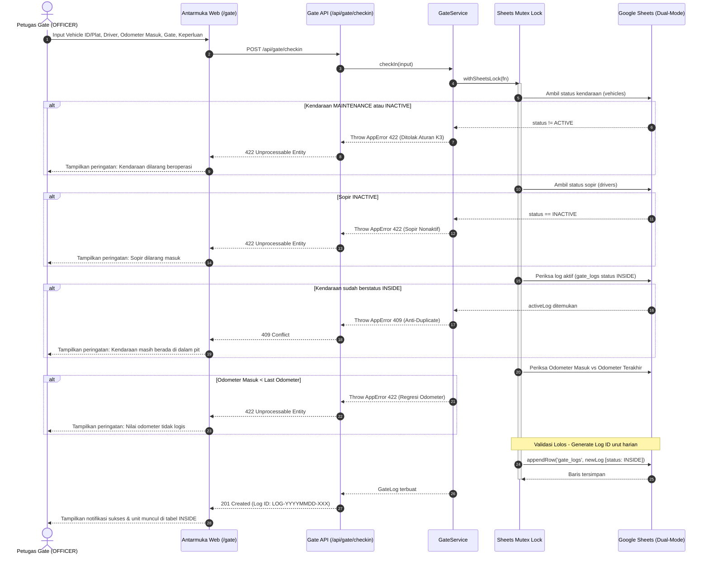
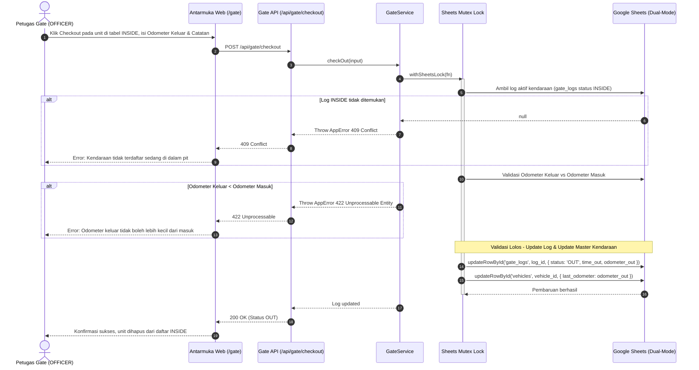
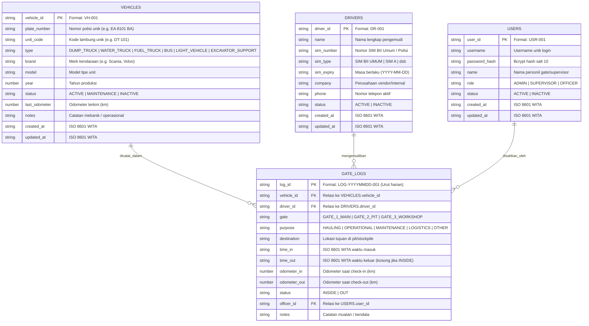
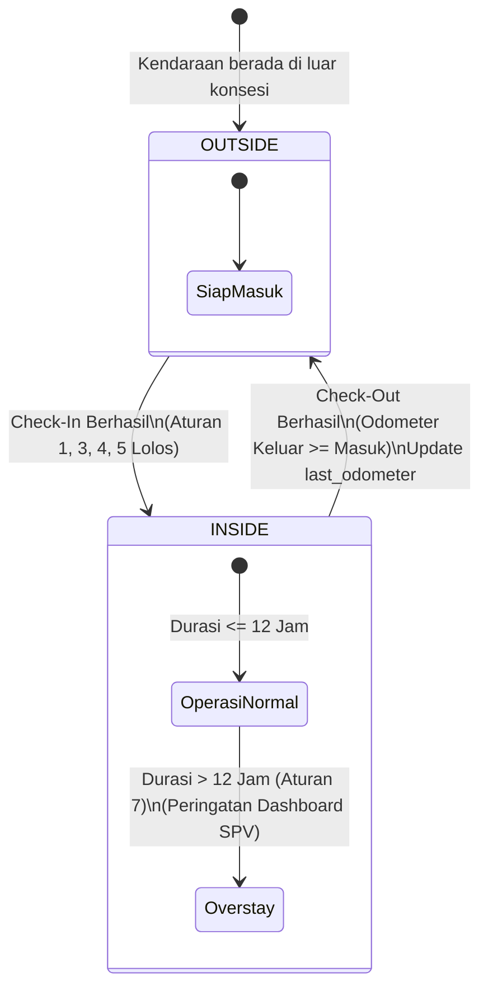

# Dokumentasi Alur Operasional & ERD MINEGATE

Dokumen ini memuat diagram alur proses bisnis gerbang tambang (*check-in* & *check-out*), diagram entitas relasi (*ERD*), dan mesin status operasional pada sistem **MINEGATE**.

---

## 1. Alur Check-In Kendaraan (Sequence Diagram)

Diagram berikut menjelaskan verifikasi K3 dan validasi anti-duplikasi saat kendaraan tiba di gerbang masuk.

---

## 2. Alur Check-Out Kendaraan (Sequence Diagram)

Diagram berikut menjelaskan verifikasi pelepasan muatan, validasi odometer keluar, serta pembaruan odometer kendaraan pada Google Sheets.

---

## 3. Entity Relationship Diagram (ERD) Google Sheets

Meskipun disimpan di dalam Google Sheets tanpa *foreign key constraints* di tingkat basis data, relasi logis antar tab dipelihara secara ketat oleh *Repository Layer* dan *Service Layer*.

---

## 4. Siklus Hidup Status Kendaraan & Log Operasional

